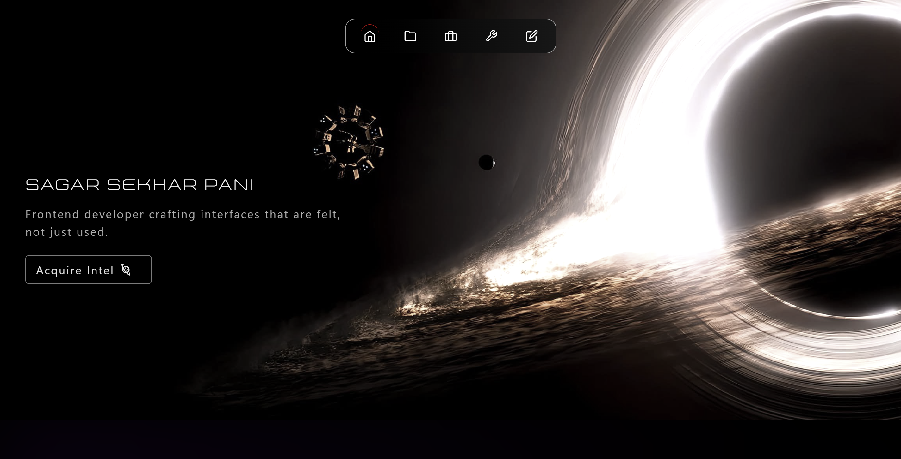

# SagarEvolves.dev

> A space-inspired developer portfolio built to showcase projects, creativity, growth, and the journey behind every line of code.

## About the Project

SagarEvolves.dev is more than a collection of projects.

The journey began with something almost forgettable; a simple HTML bookmark.

There was no ambitious roadmap or clearly defined destination. Just curiosity: the desire to understand how the web worked, build something small, improve it, and eventually create experiences that felt meaningful.

Over time, curiosity became consistency.

Consistency became craft.

This portfolio is a reflection of that journey; a place where ideas became interfaces, experiments became projects, and learning became something that could be built, refined, and shared.

It is not intended to represent a final destination. Instead, it captures a journey that is still unfolding.

---

## Design Philosophy

The portfolio draws inspiration from the vastness and mystery of space.

The space theme represents exploration: entering unfamiliar territory, learning through experimentation, and continuing to move forward without knowing exactly where the journey will lead.

Every section is designed to feel like part of a larger experience rather than an isolated page. Motion, depth, spacing, and visual details work together to create an immersive atmosphere.

Typography plays a major role in the design. It is not used only to display information; it helps shape the personality, rhythm, and visual identity of the portfolio.

The goal was to create an experience that feels:

*  Immersive and cinematic
*  Creative without sacrificing clarity
*  Modern and interactive
*  Spacious and visually expressive
*  Thoughtful in its use of motion and typography

---

## Features

* Responsive developer portfolio
* Space-inspired visual design
* Modern and expressive typography
* Smooth animations and transitions
* Interactive user interface
* Project showcase
* Personal journey and experience sections
* Dedicated navigation between portfolio sections
* Carefully designed layouts with attention to spacing and visual detail
* Optimised development and production workflow using Vite

---

## Built With

* **React 19** ;  Component-based user interface development
* **Vite 8** ;  Fast development server and production build tooling
* **Tailwind CSS 4** ;  Utility-first styling and responsive design
* **Framer Motion** ;  Smooth animations and interactive motion
* **React Router 7** ;  Client-side navigation and routing
* **ESLint** ;  Code-quality and consistency checks


## The Journey Behind It

Every project has a beginning.

For this one, the beginning was not a polished design, a detailed plan, or a finished vision. It was curiosity.

The journey involved:

```text
Curiosity
    ↓
Learning
    ↓
Experimentation
    ↓
Consistency
    ↓
Growth
    ↓
Craft
```

The portfolio brings together the lessons learned through that process; the early experiments, the small wins, the countless iterations, and the moments when something that once felt difficult finally began to make sense.

Growth was happening even when it was difficult to see.

This project is a reminder of that.

---

## Preview




---

## Live Portfolio

**Explore the portfolio:**

[SagarEvolves.dev](https://sagar-evolves-dev.vercel.app/)

For the complete visual experience, viewing the portfolio on a laptop or desktop is recommended.

The experience was designed with space, motion, typography, and visual detail in mind; something intended to be felt as much as it is seen.

---

## Future Improvements

The portfolio will continue evolving as new skills, projects, and ideas become part of the journey.

Potential improvements include:

* Additional project case studies
* Improved accessibility
* More interactive visual experiences
* Performance enhancements
* New animations and micro-interactions
* Expanded project information
* New sections as the portfolio grows

---

## Connect

If you enjoyed exploring the portfolio, feel free to connect or reach out.

* **Portfolio:** [https://sagar-evolves-dev.vercel.app/](https://sagar-evolves-dev.vercel.app/)
* **GitHub:** [https://github.com/sagarpani/SagarEvolves.dev](https://github.com/sagarpani/SagarEvolves.dev)
* **LinkedIn:** [https://www.linkedin.com/in/sagarpani/](https://www.linkedin.com/in/sagarpani/)

---

## License

This project is intended as a personal developer portfolio.

The source code may be used for learning and inspiration. Please avoid directly copying the design, content, branding, or personal project information.

---

## Final Note

This portfolio is not a final destination.

It is a collection of moments; where ideas became interfaces, learning became something tangible, and curiosity slowly turned into craft.

The journey is still unfolding.

**Thank you for being here.**
